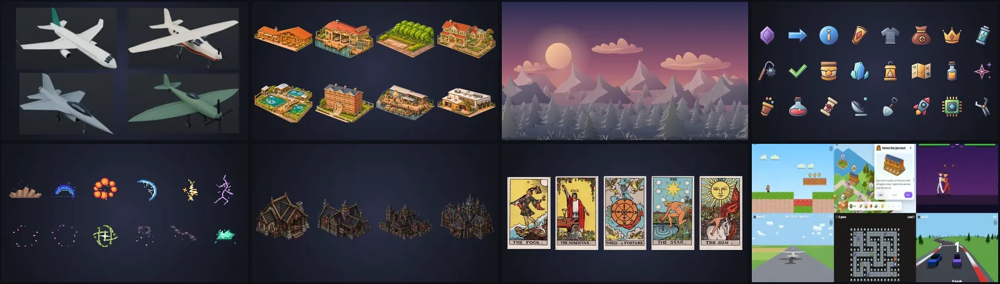
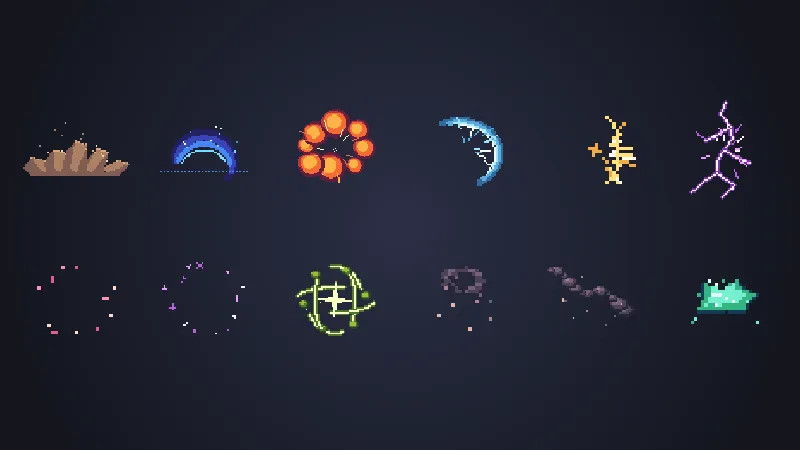
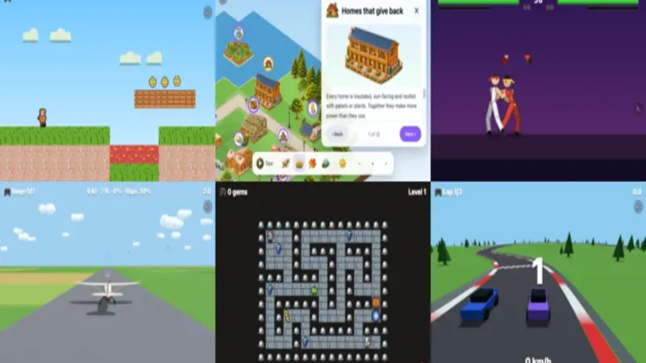

# Zuujis CC0 game assets

**Free art, 3D models, sounds and game starters for anyone making games.** 
Everything here is public domain under [CC0 1.0](https://creativecommons.org/publicdomain/zero/1.0/): use it in personal or commercial games,
change it however you like, no credit needed.

[**Browse every pack**](https://github.com/zuujis-cc0/free-game-assets#readme) ·
[**Pick single files on games.zuujis.com**](https://games.zuujis.com/assets) ·
[**Game scripts and starters**](https://github.com/zuujis-cc0/zuujis-game-scripts#readme) ·
[**More CC0 sources**](https://github.com/zuujis-cc0/free-game-assets/blob/main/MORE-CC0.md)

## The packs

Each pack has its own repository where every file can be opened and saved on its own, a ZIP of the whole pack, and a
page on games.zuujis.com with a small picture and a download link for each item.

<table>
<tr>
<td width="50%" valign="top">

### ✈️ Aircraft models
24 self-contained 3D aircraft (GLB): airliners, business jets, fighters and classics. Ready for three.js, Godot, Unity and Blender.

[Files](https://github.com/zuujis-cc0/free-game-assets-aircraft) · [ZIP 4.2 MB](https://github.com/zuujis-cc0/free-game-assets/releases/download/v1.0.0/zuujis-aircraft-glb.zip) · [Pick items](https://games.zuujis.com/free-assets/aircraft) · [Gallery](https://github.com/zuujis-cc0/free-game-assets/blob/main/previews/aircraft/README.md)
</td>
<td width="50%" valign="top">

### 🏙️ From the Ground Up
Painted city-builder art: buildings at several levels, people, props, interface icons and menu artwork.

[Files](https://github.com/zuujis-cc0/free-game-assets-from-the-ground-up) · [ZIP 12.4 MB](https://github.com/zuujis-cc0/free-game-assets/releases/download/v1.0.0/zuujis-from-the-ground-up-2d.zip) · [Pick items](https://games.zuujis.com/free-assets/from-the-ground-up) · [Gallery](https://github.com/zuujis-cc0/free-game-assets/blob/main/previews/from-the-ground-up/README.md)
</td>
</tr>
<tr>
<td width="50%" valign="top">

### 🌄 Parallax backgrounds
Six layered scenes (meadow, forest, desert, snow, city at night, alien planet) and transparent clouds for side-scrollers.

[Files](https://github.com/zuujis-cc0/free-game-assets-backgrounds) · [ZIP 3.6 MB](https://github.com/zuujis-cc0/free-game-assets/releases/download/v1.0.0/zuujis-parallax-backgrounds.zip) · [Pick items](https://games.zuujis.com/free-assets/backgrounds) · [Gallery](https://github.com/zuujis-cc0/free-game-assets/blob/main/previews/backgrounds/README.md)
</td>
<td width="50%" valign="top">

### 🎒 Game icons
128 inventory and interface icons: weapons, armour, potions, gems, food, tools and arrows, with a sprite atlas and editable vectors.

[Files](https://github.com/zuujis-cc0/free-game-assets-icons) · [ZIP 4.5 MB](https://github.com/zuujis-cc0/free-game-assets/releases/download/v1.0.0/zuujis-game-icons.zip) · [Pick items](https://games.zuujis.com/free-assets/icons) · [Gallery](https://github.com/zuujis-cc0/free-game-assets/blob/main/previews/icons/README.md)
</td>
</tr>
<tr>
<td width="50%" valign="top">

### ✨ Pixel effects
48 animated pixel effects as sprite strips: fire, ice, lightning, magic, explosions, impacts, smoke and splatters.

[Files](https://github.com/zuujis-cc0/free-game-assets-effects) · [ZIP 165 KB](https://github.com/zuujis-cc0/free-game-assets/releases/download/v1.0.0/zuujis-pixel-effects.zip) · [Pick items](https://games.zuujis.com/free-assets/effects) · [Gallery](https://github.com/zuujis-cc0/free-game-assets/blob/main/previews/effects/README.md)
</td>
<td width="50%" valign="top">

### 🏰 Covenant Hall
30 painted building levels for a hall that grows as the player builds, plus the four keyframes they were made from.

[Files](https://github.com/zuujis-cc0/free-game-assets-covenant-hall) · [ZIP 17 MB](https://github.com/zuujis-cc0/free-game-assets/releases/download/v1.0.0/zuujis-covenant-hall.zip) · [Pick items](https://games.zuujis.com/free-assets/covenant-hall) · [Gallery](https://github.com/zuujis-cc0/free-game-assets/blob/main/previews/covenant-hall/README.md)
</td>
</tr>
<tr>
<td width="50%" valign="top">

### 🔮 Tarot artwork
478 card images: full decks, alternate designs, and the Rider-Waite-Smith deck in two resolutions.

[Files](https://github.com/zuujis-cc0/free-game-assets-tarot) · [ZIP 927 MB](https://github.com/zuujis-cc0/free-game-assets/releases/download/v1.0.0/zuujis-tarot-art.zip) · [Pick items](https://games.zuujis.com/free-assets/tarot) · [Gallery](https://github.com/zuujis-cc0/free-game-assets/blob/main/previews/tarot/README.md)
</td>
<td width="50%" valign="top">

### 🕹️ Game scripts and starters
The browser game scripts behind games.zuujis.com (keyboard, gamepad and touch) and 15 starter games to copy and change, with the art and sounds they use.

[Files](https://github.com/zuujis-cc0/zuujis-game-scripts) · [ZIP 38 MB](https://github.com/zuujis-cc0/free-game-assets/releases/download/v1.1.0/zuujis-game-scripts.zip) · [Pick items](https://games.zuujis.com/free-assets/game-scripts) · [How to use them](https://github.com/zuujis-cc0/zuujis-game-scripts#readme)
</td>
</tr>
</table>

## Get involved

- **Made something with these?** [Tell us about it](https://github.com/zuujis-cc0/free-game-assets/issues/new?template=asset-use.yml): it shows what is worth making next.
- **Want to add assets?** Your own work, or CC0 work you can link the licence for: [start with an issue](https://github.com/zuujis-cc0/free-game-assets/issues/new?template=new-assets.yml), then read [CONTRIBUTING](https://github.com/zuujis-cc0/free-game-assets/blob/main/CONTRIBUTING.md).
- **Something broken?** [Report a problem](https://github.com/zuujis-cc0/free-game-assets/issues/new?template=problem.yml), or ask in [Discussions](https://github.com/zuujis-cc0/free-game-assets/discussions).
- **Need to tell us something privately?** Use the [report form](https://games.zuujis.com/report). Everyone here follows the [code of conduct](https://github.com/zuujis-cc0/free-game-assets/blob/main/CODE_OF_CONDUCT.md).

Made by <a href="https://games.zuujis.com">Zuujis</a> · Play free games at <a href="https://games.zuujis.com">games.zuujis.com</a> · Dedicated to the public domain with CC0 1.0

