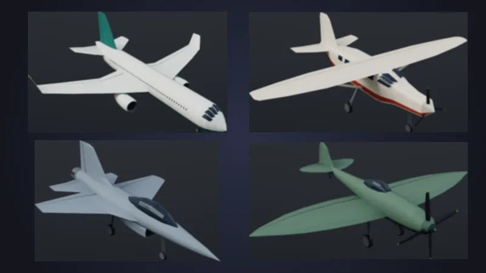
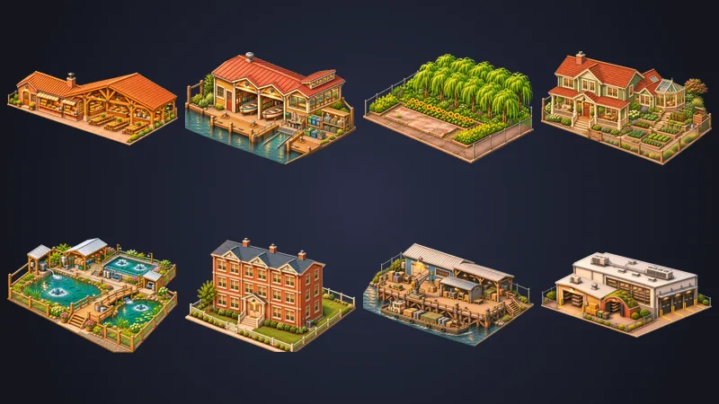
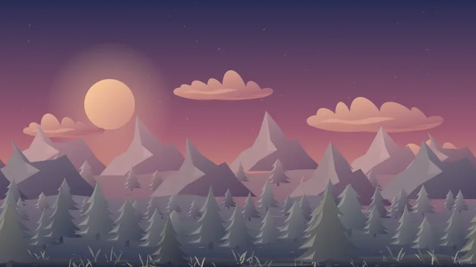
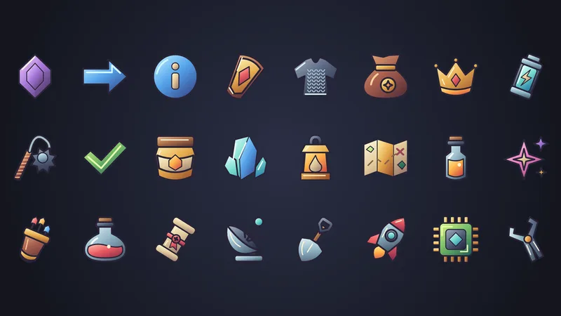
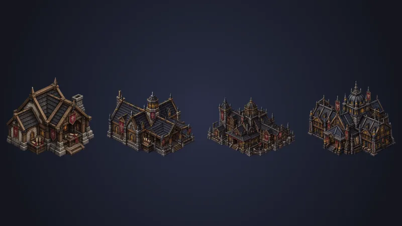
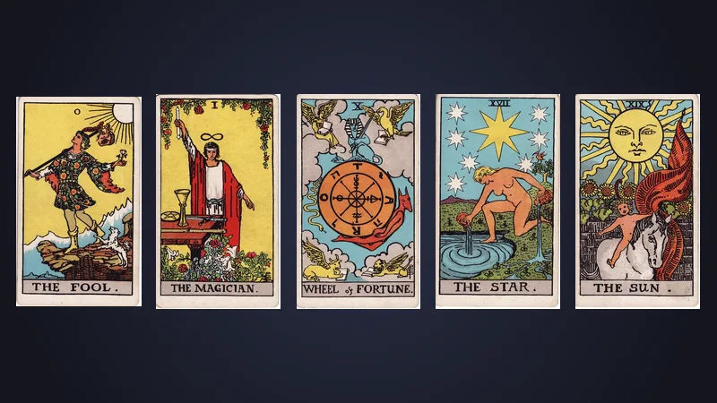
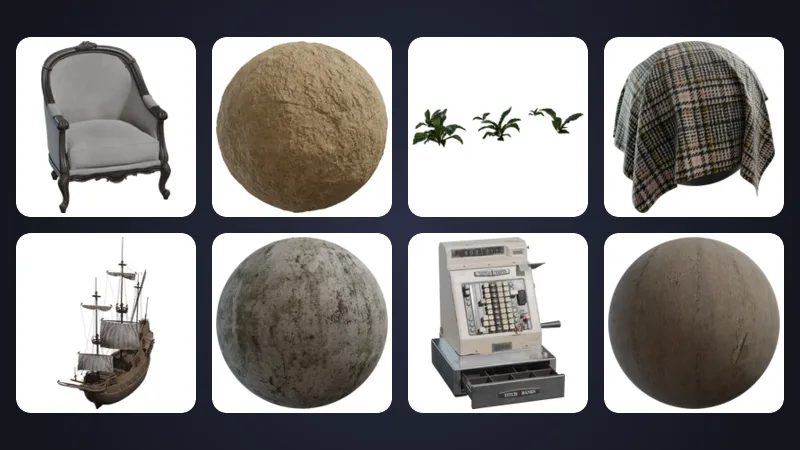
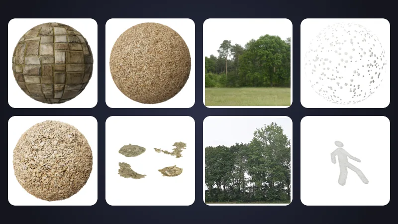

# Zuujis CC0 game assets

**Free art, 3D models, sounds and game starters for anyone making games.** 
Everything here is public domain under [CC0 1.0](https://creativecommons.org/publicdomain/zero/1.0/): use it in personal or commercial games,
change it however you like, no credit needed.

[**Browse every pack**](https://github.com/zuujis-cc0/free-game-assets#readme) ·
[**Pick single files on games.zuujis.com**](https://games.zuujis.com/assets) ·
[**Game scripts and starters**](https://github.com/zuujis-cc0/zuujis-game-scripts#readme) ·
[**More CC0 sources**](https://github.com/zuujis-cc0/free-game-assets/blob/main/MORE-CC0.md)

## The packs

Each pack has its own repository where every file can be opened and saved on its own, a ZIP of the whole pack, and a
page on games.zuujis.com with a small picture and a download link for each item.

<table>
<tr>
<td width="50%" valign="top">

### ✈️ Aircraft models
24 self-contained 3D aircraft (GLB): airliners, business jets, fighters and classics. Ready for three.js, Godot, Unity and Blender.

[Files](https://github.com/zuujis-cc0/free-game-assets-aircraft) · [ZIP 4.2 MB](https://github.com/zuujis-cc0/free-game-assets/releases/download/v1.0.0/zuujis-aircraft-glb.zip) · [Pick items](https://games.zuujis.com/free-assets/aircraft) · [Gallery](https://github.com/zuujis-cc0/free-game-assets/blob/main/previews/aircraft/README.md)
</td>
<td width="50%" valign="top">

### 🏙️ From the Ground Up
Painted city-builder art: buildings at several levels, people, props, interface icons and menu artwork.

[Files](https://github.com/zuujis-cc0/free-game-assets-from-the-ground-up) · [ZIP 12.4 MB](https://github.com/zuujis-cc0/free-game-assets/releases/download/v1.0.0/zuujis-from-the-ground-up-2d.zip) · [Pick items](https://games.zuujis.com/free-assets/from-the-ground-up) · [Gallery](https://github.com/zuujis-cc0/free-game-assets/blob/main/previews/from-the-ground-up/README.md)
</td>
</tr>
<tr>
<td width="50%" valign="top">

### 🌄 Parallax backgrounds
Six layered scenes (meadow, forest, desert, snow, city at night, alien planet) and transparent clouds for side-scrollers.

[Files](https://github.com/zuujis-cc0/free-game-assets-backgrounds) · [ZIP 3.6 MB](https://github.com/zuujis-cc0/free-game-assets/releases/download/v1.0.0/zuujis-parallax-backgrounds.zip) · [Pick items](https://games.zuujis.com/free-assets/backgrounds) · [Gallery](https://github.com/zuujis-cc0/free-game-assets/blob/main/previews/backgrounds/README.md)
</td>
<td width="50%" valign="top">

### 🎒 Game icons
128 inventory and interface icons: weapons, armour, potions, gems, food, tools and arrows, with a sprite atlas and editable vectors.

[Files](https://github.com/zuujis-cc0/free-game-assets-icons) · [ZIP 4.5 MB](https://github.com/zuujis-cc0/free-game-assets/releases/download/v1.0.0/zuujis-game-icons.zip) · [Pick items](https://games.zuujis.com/free-assets/icons) · [Gallery](https://github.com/zuujis-cc0/free-game-assets/blob/main/previews/icons/README.md)
</td>
</tr>
<tr>
<td width="50%" valign="top">

### ✨ Pixel effects
48 animated pixel effects as sprite strips: fire, ice, lightning, magic, explosions, impacts, smoke and splatters.

[Files](https://github.com/zuujis-cc0/free-game-assets-effects) · [ZIP 165 KB](https://github.com/zuujis-cc0/free-game-assets/releases/download/v1.0.0/zuujis-pixel-effects.zip) · [Pick items](https://games.zuujis.com/free-assets/effects) · [Gallery](https://github.com/zuujis-cc0/free-game-assets/blob/main/previews/effects/README.md)
</td>
<td width="50%" valign="top">

### 🏰 Covenant Hall
30 painted building levels for a hall that grows as the player builds, plus the four keyframes they were made from.

[Files](https://github.com/zuujis-cc0/free-game-assets-covenant-hall) · [ZIP 17 MB](https://github.com/zuujis-cc0/free-game-assets/releases/download/v1.0.0/zuujis-covenant-hall.zip) · [Pick items](https://games.zuujis.com/free-assets/covenant-hall) · [Gallery](https://github.com/zuujis-cc0/free-game-assets/blob/main/previews/covenant-hall/README.md)
</td>
</tr>
<tr>
<td width="50%" valign="top">

### 🔮 Tarot artwork
478 card images: full decks, alternate designs, and the Rider-Waite-Smith deck in two resolutions.

[Files](https://github.com/zuujis-cc0/free-game-assets-tarot) · [ZIP 927 MB](https://github.com/zuujis-cc0/free-game-assets/releases/download/v1.0.0/zuujis-tarot-art.zip) · [Pick items](https://games.zuujis.com/free-assets/tarot) · [Gallery](https://github.com/zuujis-cc0/free-game-assets/blob/main/previews/tarot/README.md)
</td>
<td width="50%" valign="top">

### 🕹️ Game scripts and starters
The browser game scripts behind games.zuujis.com (keyboard, gamepad and touch) and 15 starter games to copy and change, with the art and sounds they use.

[Files](https://github.com/zuujis-cc0/zuujis-game-scripts) · [ZIP 38 MB](https://github.com/zuujis-cc0/free-game-assets/releases/download/v1.1.0/zuujis-game-scripts.zip) · [Pick items](https://games.zuujis.com/free-assets/game-scripts) · [How to use them](https://github.com/zuujis-cc0/zuujis-game-scripts#readme)
</td>
</tr>
</table>

<!-- mirrors:start -->
## Mirrors of other CC0 sources

Copies of other people's CC0 work, so game makers can take single files straight from GitHub. Each repository holds one category (under 1 GB), credits its source and lists every file with its size and SHA-256, and **fills and updates itself** every week. They are made by [cc0-mirror](https://github.com/zuujis-cc0/cc0-mirror); the sources are not affiliated with us, and their own sites have the originals in more formats and sizes. Please support them.

<table>
<tr>
<td width="33%" valign="top">

### 🏞️ Poly Haven
Photo-scanned textures (1K and 2K maps), glTF models and HDRI skies, one repository per category.

**2,392 assets in 64 repositories, 36.7 GB.** 63 of 64 filled so far.

[All repositories](https://github.com/orgs/zuujis-cc0/repositories?q=polyhaven-) · [polyhaven.com](https://polyhaven.com) · [Support Poly Haven](https://www.patreon.com/polyhaven/overview)
</td>
<td width="33%" valign="top">

### 🧱 ambientCG
PBR materials, decals, atlases and terrains (1K and 2K), HDRIs, low-poly models and Substance files.

**2,933 assets in 108 repositories, 73.1 GB.** 107 of 108 filled so far.

[All repositories](https://github.com/orgs/zuujis-cc0/repositories?q=ambientcg-) · [ambientcg.com](https://ambientcg.com) · [Support ambientCG](https://www.patreon.com/ambientCG)
</td>
<td width="33%" valign="top">

### 🎮 OpenGameArt
Every CC0 entry as uploaded (ZIPs unpacked), Kenney's and Quaternius's uploads first. OpenGameArt asks for ten seconds between requests, so this one grows a little every day.

**Being catalogued now;** its repositories appear here as they are made.

[All repositories](https://github.com/orgs/zuujis-cc0/repositories?q=opengameart-) · [opengameart.org](https://opengameart.org) · [Support OpenGameArt](https://opengameart.org/content/faq)
</td>
</tr>
</table>

### Browse by topic

Too many repositories to list here, so [**the catalogue**](https://github.com/zuujis-cc0/cc0-catalog#readme) groups all 5,325 assets by what they are, across sources, with a picture of each.

**🧱 Textures and materials:** [Wood](https://github.com/zuujis-cc0/cc0-catalog/blob/main/topics/wood.md) (526) · [Brick and block](https://github.com/zuujis-cc0/cc0-catalog/blob/main/topics/brick.md) (302) · [Stone and rock](https://github.com/zuujis-cc0/cc0-catalog/blob/main/topics/stone.md) (353) · [Roads and paving](https://github.com/zuujis-cc0/cc0-catalog/blob/main/topics/paving.md) (283) · [Tiles and roofing](https://github.com/zuujis-cc0/cc0-catalog/blob/main/topics/tiles.md) (251) · [Concrete, plaster and walls](https://github.com/zuujis-cc0/cc0-catalog/blob/main/topics/walls.md) (267) · [Ground, grass and snow](https://github.com/zuujis-cc0/cc0-catalog/blob/main/topics/ground.md) (411) · [Metal](https://github.com/zuujis-cc0/cc0-catalog/blob/main/topics/metal.md) (290) · [Fabric and leather](https://github.com/zuujis-cc0/cc0-catalog/blob/main/topics/fabric.md) (252) · [Dirt, scratches and wear](https://github.com/zuujis-cc0/cc0-catalog/blob/main/topics/wear.md) (66) · [Plastic, paper and more](https://github.com/zuujis-cc0/cc0-catalog/blob/main/topics/other-surfaces.md) (133)

**🩹 Decals and atlases:** [Decals](https://github.com/zuujis-cc0/cc0-catalog/blob/main/topics/decals.md) (127) · [Atlases and brushes](https://github.com/zuujis-cc0/cc0-catalog/blob/main/topics/atlases.md) (65)

**🌅 HDRI skies and scenes:** [Daytime skies](https://github.com/zuujis-cc0/cc0-catalog/blob/main/topics/sky-day.md) (231) · [Sunset and night](https://github.com/zuujis-cc0/cc0-catalog/blob/main/topics/sky-night.md) (131) · [Countryside and nature](https://github.com/zuujis-cc0/cc0-catalog/blob/main/topics/scene-nature.md) (459) · [Towns and industry](https://github.com/zuujis-cc0/cc0-catalog/blob/main/topics/scene-town.md) (241) · [Other outdoor scenes](https://github.com/zuujis-cc0/cc0-catalog/blob/main/topics/scene-outdoor.md) (118) · [Interiors and studios](https://github.com/zuujis-cc0/cc0-catalog/blob/main/topics/scene-indoor.md) (263)

**🪑 3D models:** [Furniture, decor and lights](https://github.com/zuujis-cc0/cc0-catalog/blob/main/topics/furniture.md) (151) · [Plants, rocks and nature](https://github.com/zuujis-cc0/cc0-catalog/blob/main/topics/nature-models.md) (103) · [Food and kitchen](https://github.com/zuujis-cc0/cc0-catalog/blob/main/topics/food.md) (67) · [Tools and weapons](https://github.com/zuujis-cc0/cc0-catalog/blob/main/topics/tools.md) (65) · [Vehicles](https://github.com/zuujis-cc0/cc0-catalog/blob/main/topics/vehicles.md) (11) · [Buildings and industry](https://github.com/zuujis-cc0/cc0-catalog/blob/main/topics/buildings.md) (37) · [Everyday objects](https://github.com/zuujis-cc0/cc0-catalog/blob/main/topics/objects.md) (122)

Coming next: links-only lists of CC0 packs on itch.io and Freesound (downloads stay on their sites).
<!-- mirrors:end -->

## Get involved

- **Made something with these?** [Tell us about it](https://github.com/zuujis-cc0/free-game-assets/issues/new?template=asset-use.yml): it shows what is worth making next.
- **Want to add assets?** Your own work, or CC0 work you can link the licence for: [start with an issue](https://github.com/zuujis-cc0/free-game-assets/issues/new?template=new-assets.yml), then read [CONTRIBUTING](https://github.com/zuujis-cc0/free-game-assets/blob/main/CONTRIBUTING.md).
- **Something broken?** [Report a problem](https://github.com/zuujis-cc0/free-game-assets/issues/new?template=problem.yml), or ask in [Discussions](https://github.com/zuujis-cc0/free-game-assets/discussions).
- **Need to tell us something privately?** Use the [report form](https://games.zuujis.com/report). Everyone here follows the [code of conduct](https://github.com/zuujis-cc0/free-game-assets/blob/main/CODE_OF_CONDUCT.md).

Made by <a href="https://games.zuujis.com">Zuujis</a> · Play free games at <a href="https://games.zuujis.com">games.zuujis.com</a> · Dedicated to the public domain with CC0 1.0

